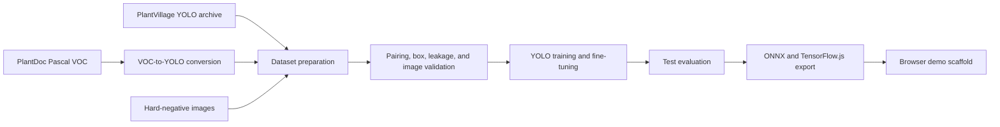

# Leaf Object Detection

[](https://github.com/fishman7337/leaf-object-detection/actions/workflows/ci.yml)
[](https://www.python.org/)
[](https://docs.ultralytics.com/)

Reproducible single-class YOLO pipeline for preparing mixed leaf imagery,
validating annotations, training detector variants on Colab, exporting ONNX or
TensorFlow.js assets, and prototyping browser inference.

## Evidence and interpretation

| Evidence-backed measure | Current repository evidence |
| --- | --- |
| Recorded preparation run | **57,164 images** and **63,225 boxes**, comprising 54,293 PlantVillage images, 2,571 PlantDoc images, and 300 synthetic negatives. |
| Deterministic split | **46,008 train / 5,460 validation / 5,696 test images** with portable, collision-resistant filenames. |

The qualitative outcome is a reproducible single-class leaf-detection dataset pipeline with validation and training entry points. Counts describe prepared data, not detector accuracy; no benchmark claim is made without a pinned model run.

## Overview

The project combines centered PlantVillage images, PlantDoc scenes, and
synthetic hard negatives into one `leaf` class. Its tooling validates image and
label pairing, converts Pascal VOC boxes to normalized YOLO coordinates,
creates deterministic train/validation/test splits, trains candidate detectors,
and records evaluation/export metadata.

The project is designed for research and education. It does not include the
source datasets, trained weights, or generated runs in Git.

## Recorded dataset composition

The latest documented preparation run produced the following counts. Regenerate
`datasets/leaf_yolo/stats.json` and `validation_report.json` before citing these
numbers for a new dataset revision.

| Measure | Count |
| --- | ---: |
| Images | 57,164 |
| Leaf bounding boxes | 63,225 |
| PlantVillage images | 54,293 |
| PlantDoc images | 2,571 |
| Synthetic hard negatives | 300 |
| Training images / boxes | 46,008 / 51,905 |
| Validation images / boxes | 5,460 / 5,432 |
| Test images / boxes | 5,696 / 5,888 |

These counts are pipeline outputs, not model-performance claims. Final model
quality must be reported from a fresh test evaluation using recall, precision,
mAP50–95, false positives on negative images, model size, and browser latency.

## Architecture



## Repository structure

```text
.
|-- .github/workflows/ci.yml       # Python quality and test matrix
|-- scripts/                       # Preparation, validation, training, export
|-- tests/                         # Offline deterministic unit tests
|-- web/                           # Browser ONNX demo scaffold
|-- colab_leaf_yolo_training.ipynb # Colab orchestration notebook
|-- COLAB_A100_STEPS.md            # A100 runbook
|-- pyproject.toml                 # Package and quality-tool configuration
`-- requirements-colab.txt         # Full Colab training/export stack
```

## Installation

For dataset tooling and offline tests:

```bash
python -m venv .venv
source .venv/bin/activate  # Windows PowerShell: .venv\Scripts\Activate.ps1
python -m pip install --upgrade pip
python -m pip install -e ".[dev]"
```

For training and export, use Colab or install the larger optional stack:

```bash
python -m pip install -e ".[train]"
```

## Usage

Prepare a dataset from a local archive and optional additional sources:

```bash
python scripts/prepare_leaf_dataset.py \
  --archive archive.zip \
  --work-dir . \
  --extra-yolo-dir public/plantdoc_yolo \
  --hard-negatives-dir hard_negatives/synthetic \
  --force
```

Validate pairing, image readability, class IDs, normalized boxes, and split
leakage:

```bash
python scripts/validate_leaf_dataset.py \
  --dataset datasets/leaf_yolo \
  --write-report
```

Generate temporary synthetic negatives:

```bash
python scripts/generate_synthetic_negatives.py --count 300 --seed 42
```

For Colab A100 training, open the notebook below and follow
[`COLAB_A100_STEPS.md`](COLAB_A100_STEPS.md).

[](https://colab.research.google.com/github/fishman7337/leaf-object-detection/blob/main/colab_leaf_yolo_training.ipynb)

## Training and evaluation

The main run compares `yolo26s.pt`, `yolo26m.pt`, and `yolo26x.pt` with a
640-pixel input, pretrained weights, deterministic seed 42, early stopping,
cosine learning rate, and configurable fine-tuning. A 20-epoch `yolo26s` smoke
run is available before the full experiment:

```bash
python scripts/train_leaf_yolo.py --smoke --data datasets/leaf_yolo/data.yaml
```

Use `--export` only after confirming test evaluation. The training script writes
`training_summary.json` with metrics and artifact paths.

## Testing

Run the complete offline quality gate:

```bash
python -m ruff check scripts tests
python -m ruff format --check scripts tests
python -m pytest --cov=scripts --cov-report=term-missing
python -m compileall -q scripts tests
```

CI runs these checks on Python 3.10, 3.11, and 3.12. Dataset preparation and GPU
training are intentionally excluded because they require external data and
specialized compute.

## Deployment

Place an exported ONNX model at `web/models/best.onnx`, then serve `web/` from a
local HTTP server. Start with the smallest detector whose measured recall and
false-positive behavior meet the deployment requirement; browser FPS must be
measured on the actual target device.

## Limitations

- PlantVillage is dominated by centered, controlled images and does not fully
  represent live webcam scenes.
- Synthetic negatives supplement but do not replace real no-leaf camera frames.
- The recorded dataset counts can change when upstream datasets or split logic change.
- No production latency, accuracy, or user-impact claim is made without a
  reproducible evaluation artifact.

## Data, privacy, and licensing

Do not commit Kaggle credentials, private imagery, datasets, model weights, or
generated runs. The referenced PlantVillage object-detection dataset is hosted
under CC BY-NC-SA 4.0; verify every upstream source and model license before
redistribution or commercial use.

This repository currently does not declare a repository-wide software license.
Until the owner selects one, reuse beyond applicable law requires permission.

## Contributing

See [`CONTRIBUTING.md`](CONTRIBUTING.md) for setup, quality gates, pull-request
expectations, and data-handling rules.
